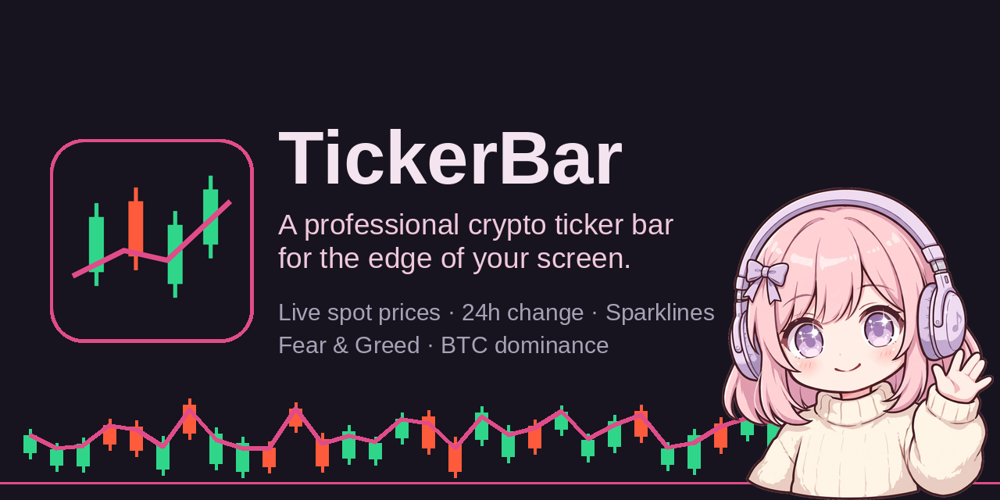

  

<h1 align="center">TickerBar</h1>

  A slim crypto ticker bar for Windows — live spot prices, 24h and 1h change, sparklines and candlestick detail for BTC, ETH, HYPE and your own watchlist, in one strip that hugs the edge of your screen.

  
  <a href="https://github.com/Corporal8065/TickerBar/releases/latest"><strong>Download latest release</strong></a>

<!-- The badge above lights up once this repo's GitHub Actions runs have
     happened; the workflow (build-windows.yml) is in the tree and builds
     every version tag. -->

TickerBar is a borderless, always-on-top bar that lives at the edge of your monitor and keeps your coins in sight while you do anything else — trade, work, game, watch a chart on the other screen. No browser tab to babysit, no phone to pick up: the prices are just *there*, updating every 20 seconds.

## Features

- **Live spot prices, honestly sourced** — the **Coinbase Exchange public API** (no account, no API key) for every Coinbase-listed coin; **CoinGecko** for HYPE. Every price is labelled by its source. The default watchlist is **BTC · ETH · HYPE**; add any other coin with a live Coinbase USD market — symbols are validated against the real product list, so typos and delisted coins are rejected with a message. The list can never be emptied by accident.
- **Every cell tells the story** — price (formatted to the precision the coin needs), **24h %** and **1h %** (green/red, and never truncated — the % gets its full width at any supported bar width), and a **24h sparkline** of hourly closes.
- **Click a cell for the full picture** — a detail card with a **candlestick chart and volume bars**, timescale switching (**24h / 7d / 30d**), 24h high/low, 24h volume, and that coin's alert editors. Feed limits are stated, not hidden: Coinbase caps one candles request at 300 (24h/7d are hourly, 30d is daily); CoinGecko supplies hourly closes only for HYPE — no OHLC, no volume, no 30d — and the chart says so.
- **Market context cells** — the **Crypto Fear & Greed index** (click it to open the index page on alternative.me) and **BTC dominance %**, refreshing on their own ~5-minute cadence, completely separate from the price feed.
- **Price alerts that can't spam** — an above and a below level per coin. A genuine crossing flashes the cell for ~12 seconds, can fire a **Windows toast notification**, and can play a soft click (off by default). A first reading never fires; an alert re-arms only after the price comes back.
- **Honest when the feed isn't** — a status dot and readout say **Live / Stale / Down**. When a feed stalls, that coin's cell greys out, keeps its last real price, and is marked STALE — staleness is tracked per coin, so one source's bad minute never greys out the others.
- **Docking + Reserve** — dock to any of the four screen edges (the **Dock** button on the bar cycles the edge) and turn on **Reserve**: maximised windows stop at the bar instead of sliding underneath it. Reserve is event-driven with dock/undock hysteresis, so it never flickers other windows. **Arrange** slides floating windows clear of the bar; **Restore** puts them back.
- **One family look** — TickerBar ships the family's **Midnight Kids** theme (the exact palette MeterBar defaults to), with Clean Dark / Flat background styles and 15–100% background opacity. Position, size and every setting persist across restarts.

## Install

1. Download **`TickerBar-Setup.exe`** from the [Releases](https://github.com/Corporal8065/TickerBar/releases) page.
2. Run it. The installer puts TickerBar in Program Files and adds a Start Menu entry; your settings live outside the app folder, so reinstalling never wipes them.
3. **SmartScreen note:** TickerBar is unsigned (it's a small independent app, not a commercial release), so Windows may show *"Windows protected your PC"*. Click **More info → Run anyway**. The installer is built from this exact source tree by the GitHub Actions workflow in this repo.

## Build from source

You need **Visual Studio 2022** with the *"Desktop development with C++"* workload. No C++ knowledge required — the build is one double-click:

- **`build.bat`** — builds the app for testing (`build-app\app\TickerBar_artefacts\Release\TickerBar.exe`).
- **`build-release.bat`** — builds the shareable installer (`dist\TickerBar-Setup.exe`, needs [Inno Setup 6](https://jrsoftware.org/isdl.php)).

The app version lives in exactly **one** place — the `project(VERSION)` line in the root `CMakeLists.txt` — and everything else (UI, installer, CI) reads from it. The pure core under `core/` (market-data parsing, alert math, reserve/arrange geometry, cell layout) has its own test suite (`tests/test_core.cpp`), which also runs in CI.

## Gallery

### Screenshots wanted

No Windows captures of TickerBar exist yet — this section deliberately ships **without** screenshots rather than with borrowed or mock-up images. If you're running TickerBar on Windows, these exact shots would complete the gallery (only real captures of TickerBar itself, please):

- The bar itself docked on a **real Windows desktop** (top or bottom edge), BTC / ETH / HYPE cells live
- The bar at a **narrow width**, showing the 24h % and 1h % fully readable in every cell
- The **detail card** open on a Coinbase coin: candlesticks + volume bars, 7d range selected
- The **detail card** open on HYPE, showing the closes-only note
- The bar **docked with Reserve on**, a maximised window stopping at the bar
- The **Settings** window (Watchlist and Window panels)
- A **toast notification** from a price alert crossing

## The family

TickerBar is one of a small family of edge-of-screen bars. Its siblings live in **their own repositories** (one app, one repo, one release feed each):

- **MeterBar** — a pretty audio meter bar (spectrum, waveform, loudness, stereometer, oscilloscope) — the family's first app, and the source of the shared Midnight Kids look.
- **SessionBar** — market-session countdowns (New York / London / Tokyo) in the same strip format.

---

*Built with [JUCE](https://juce.com) and a hand-rolled market-data core. Made with JUCE — free-license attribution.*
